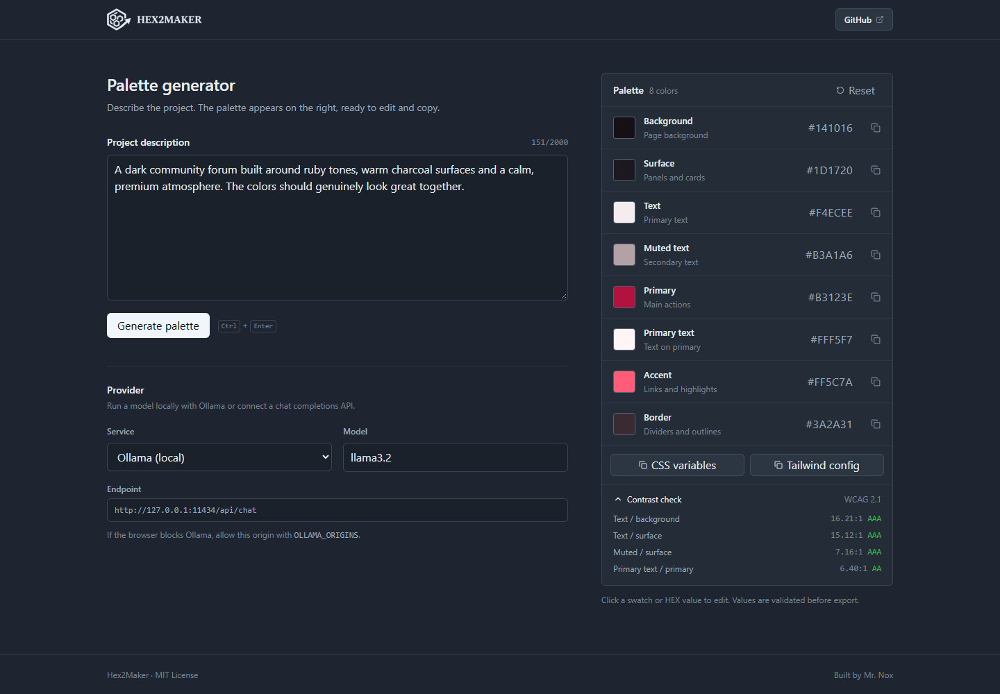

# Hex2Maker

**Describe a project. Get a palette you can ship.**

Hex2Maker is a client-side color palette generator for people who know what they are building but not which colors to use. Write a short brief, let a local Ollama model or your own chat completions API suggest eight core colors, then edit them, check contrast and copy the result.

No account, no backend, no telemetry. Close the tab and nothing is left behind except the palette in your clipboard.


---

---

---

*A dark ruby palette for a community forum, generated from the brief on the left.*

## How it works

The left side is a brief. The right side is the palette. There is no chat and no wizard to click through.

Describe the project, its audience and the mood. A couple of real sentences work better than a pile of adjectives. Then pick a model and press **Generate palette**.

You get eight tokens with fixed roles: background, surface, primary text, muted text, primary action, text on primary, accent and border. Extra tokens are welcome, up to four, if the model has a reason to add them.

Every row has a native color picker and a HEX field. Values are validated before they reach the UI. When you change a color, the contrast report and the exports update with it.

Open **Contrast check** to see the WCAG 2.1 ratios for the pairs that matter: text on background, text on surface, muted text on surface, and primary text on primary.

When it looks right, copy **CSS variables** or a **Tailwind config** and get on with the actual project.

## Quick start

You need Node.js 20 or newer.

```bash
npm install
npm run dev
```

Open the address Vite prints. It is usually `http://localhost:5173`.

| Command | What it does |
| --- | --- |
| `npm run dev` | Starts the Vite dev server. |
| `npm run build` | Builds the production app into `dist/`. |
| `npm run preview` | Serves the production build locally. |
| `npm run lint` | Runs Oxlint. |

## Choose a model

Hex2Maker does not include an API key, and no request passes through a server of mine. You bring the model.

### Ollama (local)

This is the default. If Ollama is installed and running, the endpoint is already filled in.

```bash
ollama pull llama3.2
OLLAMA_ORIGINS=http://localhost:5173,http://127.0.0.1:5173 ollama serve
```

Keep **Ollama (local)** selected and the model name set to `llama3.2`. If Vite picked a different port, use that address in `OLLAMA_ORIGINS`; Ollama only accepts origins it has been told about. On Windows PowerShell, set `$env:OLLAMA_ORIGINS` before starting `ollama serve`.

If you host the app online, add the hosted address instead of localhost.

### Any chat completions API

Select **API** in the Service dropdown, paste the full endpoint URL and enter the model name your provider expects.

The key is optional. Local servers often do not need one; hosted APIs usually do. It is sent as a bearer token directly to the URL above.

The endpoint should accept a regular chat completions request (`model` plus `messages`) and return the text in `choices[0].message.content`. Remote URLs must use HTTPS. Plain HTTP is allowed only for localhost, which is handy for LM Studio, llama.cpp and similar tools. The provider also has to allow requests from the browser.

## Palette tokens

| Token | CSS variable | Default | Role |
| --- | --- | --- | --- |
| `bg_main` | `--color-bg-main` | `#1E2530` | Page background. |
| `bg_card` | `--color-bg-card` | `#262F3B` | Panels and cards. |
| `text_main` | `--color-text-main` | `#E6EDF3` | Primary text. |
| `text_muted` | `--color-text-muted` | `#9DA7B5` | Secondary text. |
| `primary` | `--color-primary` | `#F0F6FC` | Main actions. |
| `primary_text` | `--color-primary-text` | `#0D1117` | Text on primary. |
| `accent` | `--color-accent` | `#58A6FF` | Links and highlights. |
| `border` | `--color-border` | `#3A4452` | Dividers and outlines. |

Reset restores these eight colors and removes any extra tokens.

## Security

A browser app cannot hide a key from the person using that browser, so treat this like any other client-side tool. Use a restricted or disposable key, and do not paste a production secret into a page you do not trust.

What the app does do:

- Keeps the key in the current tab's `sessionStorage`. **Forget key** clears it. It is never written to `localStorage`, cookies, a database or analytics.
- Sends requests only to the endpoint you chose: local Ollama or the API URL you entered.
- Requires every color to match `/^#([A-Fa-f0-9]{6}|[A-Fa-f0-9]{3})$/` before it is used.
- Restricts extra token names to safe identifiers and refuses reserved JavaScript property names.
- Renders everything through React, which escapes text by default. The app never uses `dangerouslySetInnerHTML`.
- Truncates provider errors and redacts the key. Authentication errors do not echo provider text.
- Gives up after 60 seconds.
- Strips Markdown fences and stray prose before parsing the model response, then still requires all eight core tokens.

## If something goes wrong

| Message | What to check |
| --- | --- |
| `Could not reach Ollama` | Is Ollama running? Does `OLLAMA_ORIGINS` include the address in your browser? |
| `The Ollama model was not found` | Pull the model first: `ollama pull <model>` |
| `The API key was rejected` | Check the key, or clear it if the endpoint does not need one. |
| `Remote API URLs must use HTTPS` | Use `https://` unless you are pointing at localhost. |
| `The API endpoint or model was not found` | Check the full URL and the model name. |
| `The API returned an empty response` | The URL may not be a chat completions endpoint, or the model returned nothing usable. |

## Under the hood

React 19, Vite 8, Tailwind CSS 4 and lucide-react. System fonts only, so the app makes no font requests.

## Project structure

```text
src/
  components/   Header, generator form, provider settings, palette panel,
                color rows, toasts
  hooks/        Session-backed state and toast management
  lib/          Palette validation and export, API client, clipboard helper
  App.jsx       State orchestration and generation flow
  index.css     Tailwind theme and shared control styles
public/
  logo.png      Wordmark used in the header
  favicon.png   Browser icon
docs/
  screenshot.png
```

## Browser support

Current Chrome, Edge, Firefox and Safari. Clipboard writes need a secure context or localhost; if the browser blocks them, the app will tell you.

## License

MIT. See [LICENSE](LICENSE).

## Thanks

If Hex2Maker is useful to you, a star on the repository is a nice way to say thanks. It helps other people find the project, and it makes maintaining it worth the time.

Built by [Mr. Nox](https://github.com/mrnoxxxdevvii).
